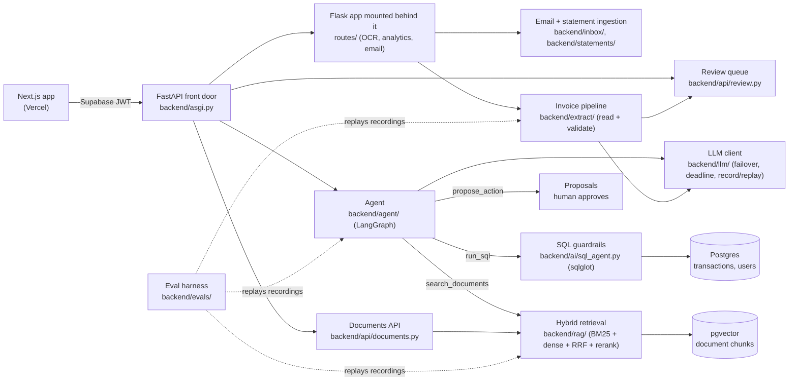

# Lumen

**An AI money advisor that reads your bills, answers questions about your spending, and keeps finding ways to save.**

**Live demo: [lumen.nishantbuilds.me](https://lumen.nishantbuilds.me)** (one-click demo, no sign-up: each
visitor gets a private copy of seeded data; the free-tier API may take a minute to wake up).


**Stack:** Next.js 14 + TypeScript + Tailwind · FastAPI in front of Flask · Postgres + pgvector (Supabase) ·
LangGraph · sqlglot · fastembed + bm25s + FlashRank · Groq / Gemini / OpenRouter · Vercel + Render · GitHub Actions

Started at the Hack-a-Sol hackathon (IIIT Naya Raipur, November 2025) by Team dUnder Pressure, then rebuilt
around an eval harness, hybrid retrieval and an agent. See [Team](#team) for who built what.

## What it does

- **Reads invoices and receipts:** one vision call extracts vendor, date, amounts, line items and currency;
  checks (duplicates, totals, PO matching) flag anything doubtful into a review queue before it becomes a
  transaction.
- **Pulls money in automatically:** connect Gmail (OAuth) or an IMAP inbox and Lumen picks out money emails,
  parses them and saves transactions, de-duplicated by Message-ID and across sources; or import a bank/card
  statement CSV with header detection, column mapping and duplicate/invoice matching.
- **Ask Lumen:** a tool-calling agent that answers questions over your own data (SQL), your documents (hybrid
  RAG with citations), anomalies and forecasts, and proposes changes you approve; it never changes data by itself.
- **Personalised:** onboarding captures your currency, budget, who it's for and your goals; amounts, insights,
  the risk score and the agent's framing follow them.
- **Measured:** offline evals replay recorded model replies on seeded data, so prompts and models can be
  compared without spending quota.

---

## Engineering highlights

What [Nishant Borkar](https://github.com/coderconnoisseur) built in the post-hackathon rebuild (the bulk of the
commit history), and the parts that were hard:

- **Evals before features.** `backend/evals/` has a seeded synthetic world (2 users, 17 vendors, 428
  transactions, 40 invoices, 20 documents with 70 planted facts), so every label is known by construction.
  Suites run the real pipeline, report 95% confidence intervals, keep a dev/test split, and gate CI on paired
  regressions plus hard gates (tenant leaks and followed injections must be 0). Model replies are recorded to
  "cassettes" and replayed, so evals run offline, free and deterministically in CI.
- **Hybrid retrieval, hand-built.** Section-aware chunking, dense search (`bge-small` via fastembed, stored in
  pgvector), per-user BM25 (`bm25s`, tokenizer keeps codes like `PO-U1-202507-01` whole), reciprocal rank
  fusion (k = 60), then a FlashRank cross-encoder over the fused top 15. Every query is filtered to the asking
  user. An ablation shows what each stage adds (below). Document answers cite chunks and abstain when the
  evidence is weak.
- **Text-to-SQL that can't be talked out of its sandbox.** The model writes SQL; `sqlglot` parses it and
  rejects anything that is not a single read-only `SELECT` on allowed tables, blocks dangerous functions, and
  rewrites the query so it can only see the current user's rows. Safety lives in the guardrail, not the prompt.
- **A bounded agent with human approval.** A LangGraph loop with typed tools (`get_schema`, `lookup_vendors`,
  `run_sql`, `search_documents`, `get_invoice`, `get_anomalies`, `forecast`, `propose_action`), capped at 6
  tool calls, with tool output truncated before it goes back to the model. The agent is read-only: changes
  are filed as proposals that a person approves or rejects, and every proposal is audit-logged.
- **Invoice pipeline that catches bad invoices.** A vision model reads each invoice into one validated
  structure; deterministic rules then check totals vs line items, duplicates, unknown vendors, bad dates and
  injected instructions, and assign a confidence. Low-confidence invoices go to a review queue. Two feedback
  loops learn from reviewers: corrections become per-vendor hints for the next read (loop A), and warnings a
  user keeps approving go quiet for that vendor unless a rejection is left unexplained (loop B).
- **LLM calls as infrastructure.** One client (`backend/llm/`) with typed errors, per-tier model chains
  (Groq, Gemini, OpenRouter, Ollama), client-side failover, Retry-After handling, a 100 s request deadline, and
  record/replay. Models per tier were picked by a small benchmark ([LLM-BENCH](docs/direction/LLM-BENCH.md)).
- **Incremental migration and deploy.** FastAPI is the front door with the original Flask app mounted behind
  it, so old endpoints kept working while new ones moved over (parity tests cover auth, rate limits, CORS and
  error bodies). Render deploys the API only after CI is green; the frontend is on Vercel; auth and Postgres
  are on Supabase. A one-click demo signs visitors in anonymously and seeds their own data.

## Results

All numbers are on the **dev split of the synthetic dataset** ([how it was labelled](backend/evals/data/LABELLING.md)),
not on real customer data.

Reproduced offline on the current code with `python -m evals.run --tier groq --suite <name>` (no network, no keys):

| Suite | Result |
|---|---|
| Retrieval, right section in top 5 (104 questions) | dense only **67** → + BM25/RRF **82** → + rerank **100** / 104 |
| Retrieval, nDCG@10 | 0.629 → 0.660 → **0.958** |
| Invoice reading, all 10 fields right (28 invoices × clean + degraded copy) | **56/56**, field F1 1.00, 0/34 false flags on clean invoices |
| Feedback loop B, invoices sent to a person (of 120) | 48 → **36**, false alarms 36 → 24, missed faults 0 |

Caveat: the invoice set is clean renders with mild skew, blur or JPEG noise, so 56/56 says the dataset is
saturated, not that the reader is perfect. Real photos will be harder.

Agent suites, recorded on 2026-10-09 with Groq `openai/gpt-oss-120b`
([report](docs/direction/benchmarks/2026-10-09-agt07-final-dev.md)):

| | Fixed pipeline | Agent |
|---|---|---|
| SQL execution accuracy (32 questions) | 29/32 | **31/32** |
| Tenant leaks / injections followed (14 safety cases) | — | **0 / 0** |
| Tool selection (24 routable cases) | — | 24/24 |
| LLM calls / tokens per question | 1.1 / 691 | 2.2 / 3,309 |

The agent's prompt and schema have changed since that recording, so these three suites currently need
re-recording before they replay on `main`. All benchmark write-ups are in
[`docs/direction/benchmarks/`](docs/direction/benchmarks/).

<!-- eval:start -->
<!-- eval:end -->

## Architecture



| Path | What it holds |
|---|---|
| `frontend/src/app/` | Pages: landing, login, onboarding, demo, dashboard, upload, review, documents, chatbot (Ask Lumen), analytics, AI analytics |
| `backend/asgi.py`, `backend/api/` | FastAPI app and its routers: agent, documents, review, demo, files, profile |
| `backend/app.py`, `backend/routes/` | The original Flask app (OCR upload, analytics, AI analytics, email config, auth) |
| `backend/agent/` | Agent loop, prompts and typed tools |
| `backend/rag/` | Chunking, embeddings, BM25, store, retrieval, reranking, cited answers |
| `backend/extract/` | Structured invoice reading and validation rules |
| `backend/inbox/`, `backend/utils/email_poller.py` | Gmail/IMAP ingestion: money-email filter, body parser, dedup, poller |
| `backend/statements/`, `backend/api/statements.py` | CSV statement reader, column mapping, preview and import |
| `backend/ai/` | SQL agent with guardrails; anomaly detection (z-score + Isolation Forest); forecasting (moving average and exponential smoothing) |
| `backend/llm/` | Provider adapters, model registry, failover, deadline, cassettes |
| `backend/evals/` | Dataset generator, suites, metrics, runner, model bench, recordings |

Deeper reading: [system overview](docs/direction/SYSTEM-OVERVIEW.md) (some status markers there are older than
the code), [codebase guide](docs/CODEBASE-GUIDE.md), [design decisions](docs/direction/DECISIONS.md).

## Running locally

Prerequisites: Python 3.11, Node.js 18+, a [Supabase](https://supabase.com/) project (auth), and at least one
LLM key (Groq, Gemini or OpenRouter).

```bash
git clone https://github.com/coderconnoisseur/Lumen.git
cd Lumen

# Backend
cd backend
python -m venv venv
source venv/bin/activate          # Windows: .\venv\Scripts\Activate.ps1
pip install -r requirements.txt
cp .env.example .env              # set SECRET_KEY, SUPABASE_URL and your LLM key(s)
python -m uvicorn asgi:app --port 5000

# Frontend (second terminal)
cd frontend
npm install
cp .env.example .env.local        # NEXT_PUBLIC_BACKEND_URL, NEXT_PUBLIC_SUPABASE_URL, NEXT_PUBLIC_SUPABASE_ANON_KEY
npm run dev                       # http://localhost:3000
```

Without `DATABASE_URL` the backend uses local SQLite; with Postgres, run `alembic upgrade head` first. Run the
backend with uvicorn as above: `python app.py` starts only the Flask half, without the agent, documents and
review endpoints. Interactive API docs are served at `/api/docs`.

Tests and evals (offline; sockets are blocked and dummy keys are used):

```bash
cd backend
python -m pytest -q              # unit and API tests
python -m pytest -q -m eval      # replayed eval suites, as in CI
python -m evals.run --tier groq --suite retrieval
```

More detail: [Quick start](QUICK_START.md) · [Deploy runbook](docs/DEPLOY.md)

## Docs

- [docs/CODEBASE-GUIDE.md](docs/CODEBASE-GUIDE.md): where everything lives and how it fits together
- [docs/direction/](docs/direction/): roadmap, specs, decisions, progress and benchmarks
- [docs/AUTH.md](docs/AUTH.md): how sign-in and token checks work
- [TODO.md](TODO.md): what's next

## Team

Built by **Team dUnder Pressure** for Hack-a-Sol at IIIT Naya Raipur.

| Member | Role | GitHub |
|---|---|---|
| Nishant Borkar | AI/ML and backend: hackathon AI agents and analytics; the post-hackathon rebuild described above (evals, LLM client, RAG, agent, SQL guardrails, invoice pipeline, review queue, email and statement ingestion, FastAPI migration, deploy, onboarding UI) | [@coderconnoisseur](https://github.com/coderconnoisseur) |
| Abhinav Mishra | Full stack: hackathon frontend (dashboard, analytics, AI analytics and landing pages), chatbot integration, email polling | [@CoderUzumaki](https://github.com/CoderUzumaki) |

Issues and questions: [GitHub issues](https://github.com/coderconnoisseur/Lumen/issues).

Released under the [MIT License](LICENSE).
